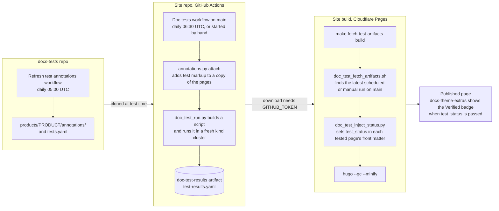
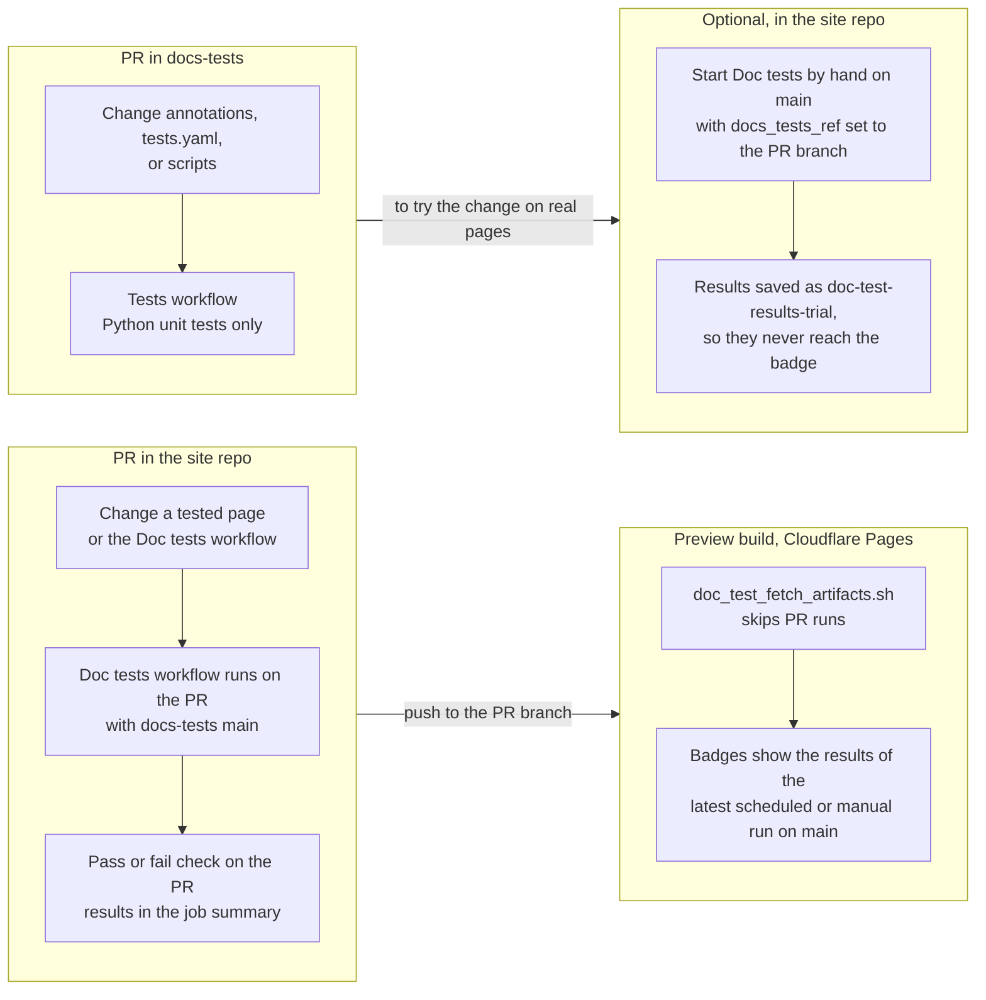

# docs-tests

Automated tests for Solo product documentation, extracted out of the doc markdown so
that guides stay readable to casual contributors and test scripts are reusable across
each product's own CI workflow.

This repo currently holds two things:

- `scripts/` — the extractor/runner tooling (`doc_test_extract.py`, `doc_test_run.py`,
  `doc_test_schema_check.py`, `doc_test_inject_status.py`, `doc_test_fetch_artifacts.sh`,
  `merge_test_results.py`, `report_summary.py`, `list_untested_docs.py`). This is the
  canonical copy — `agentgateway-oss-website`'s CI and Makefile check this repo out and
  invoke these scripts directly (`docs-tests/scripts/doc_test_run.py --repo-root .`, etc.);
  it no longer keeps its own copies.
- `products/` — the actual test content, one directory per product. For agentgateway,
  `products/agentgateway/annotations/` holds the test annotations, which mirror each doc
  page's own path (for example,
  `annotations/assets/agw-docs/pages/traffic-management/rewrite/host.md.yaml`) and are
  applied to the docs content at test time. Kept as a directory layout on `main` rather
  than a branch per product × version, and as committed, reviewable, diffable files
  rather than CI-generated artifacts.

## Dependencies

Install yamltest and cloud-provider-kind to run the tests:

```bash
npm i -y -g yamltest@latest
pip3 install PyYAML
go install sigs.k8s.io/cloud-provider-kind@latest
```

---

## How it works

1. A product's `tests.yaml` manifest (`products/<product>/<mode>/tests.yaml`) defines the test scenarios. Each one names its prerequisites and the path selectors to include from a page. A page's front matter `test:` block is still read for pages the manifest does not cover.
2. `annotations.py attach` puts the test markup (`paths=` tags and hidden `` blocks) from `products/<product>/annotations/` onto a copy of the content repo's pages. The pages themselves carry no markup.
3. `doc_test_run.py` reads the scenarios, chains the selected blocks together, and produces a standalone bash script.
4. The script is run inside a fresh `kind` cluster (with `cloud-provider-kind` for load balancer support).

---

## Test annotations

Content repos are moving to carry no test markup at all. The markup (`paths=`
tags on code blocks, hidden `` checks, and front matter `test:`)
moves into this repo as test annotations under `products/<product>/annotations/`,
one YAML file per page, and `scripts/annotations.py` attaches it to a copy of the
pages before a run.

An annotation finds its code block by fingerprint, a hash of the block's text, so
pages can move and prose can change freely. Each piece of markup ends a run in one
of three states:

| State | What happened |
|---|---|
| exact | The block's text is unchanged. |
| close | The block between the same unchanged neighbors was edited slightly, and it is the only nearly identical candidate: line similarity at least 0.6, and at least 0.1 ahead of the next candidate. |
| needs update | The block was rewritten or removed. The markup stays in the annotation file and is reported, never attached somewhere else. |

Hidden checks move only with the block or sentence they follow. A check that
follows a sentence is looked for between the same two code blocks, even when the
block before it was close-matched.

| Command | Use |
|---|---|
| `make annotate PAGE=<page>` then `make save PAGE=<page>` | Add or change the tests on one page. `annotate` writes the page with its markup to `out/annotate/`; edit the markup there; `save` writes only the markup back, and refuses if the copy changes the page itself. |
| `annotations.py attach` | Attach annotations to a checkout, in place or into `--out`. Removes any inline markup first. |
| `annotations.py refresh` | After content changes: re-attach, record the new fingerprints, and follow moved pages (git rename detection, then a search by fingerprint). Never drops markup; refuses to write if any would disappear. Inline markup still on a page is ignored: annotations are the source of truth, so refresh never copies a page's markup into them or creates annotation files for pages that gain it. It reports inline front matter `test:` edits, which need a matching `tests.yaml` change. |
| `annotations.py export` / `strip` | Migration only: copy inline markup into annotation files, then remove it from the pages. |
| `annotations.py roundtrip` | Strip and re-attach every page in memory; every page must come back byte-identical. Runs daily in CI against agentgateway/website. |
| `annotation_replay.py` | Replays a repo's git history, whose inline markup is the answer key, to measure close matching. Re-run it when matching changes; `close WRONG` must not rise. |
| `doc_test_run.py --annotation-report <attach report>` | Skips, with a warning, any scenario that would select markup which did not attach, instead of running it with a step missing. Skipped scenarios go under `skipped_needs_update` in the results, not under `tests`. |

`.github/workflows/refresh-annotations.yml` runs `refresh` daily at 05:00 UTC
against agentgateway/website `main` and commits the result to this repo's
`main`. Every scheduled run posts to `#doctopus-tests` in the same layout as the
doc test results, listing every piece of markup that needs update, with a thread
of the day's close matches and moved pages; a failed refresh also posts to
`#doctopus-builds`. Posting needs a `DOCS_TESTS_SLACK_BOT_TOKEN` secret on this
repo; until it is set, the step skips with a warning.

For agentgateway/website, every section has moved: scenario definitions live in
the `tests.yaml` manifests, so their annotations were exported with
`--front-matter none`. A manifest key must be unique, but a scenario name need
not be: set `name:` when two pages in one mode declare the same name. Pages that
deliberately have no test are listed under the manifest's `skip:` key, the
manifest form of front matter `test: skip`; the runner and
`list_untested_docs.py` count them as covered. A `skip:` entry can also be
`dir: <folder>/`, which covers every page under that folder. Use it for generated
pages, such as the agctl CLI reference, where new pages appear without anyone
editing the manifest.

---

## Referencing external test content in this repo

> [!NOTE]
> No current docs page uses the `file="..."` attribute or the `assert:` list described
> in this section. Test content now lives in the annotation files under
> `products/<product>/annotations/`. The extractor still supports both mechanisms, so
> the paths in these examples are placeholders, not real files.

The hidden `` shortcode (used for setup/assertions that must run
during tests but never appear in rendered HTML) accepts an optional `file="..."`
attribute. When present, the extractor reads the block's content from that path
resolved against a `docs-tests` checkout, instead of requiring an inline body between
the opening and closing shortcode tags:

```md

```

The referenced file (`products/<product>/<path>/rewrite.sh`
in this example) holds exactly the content that used to sit inline between the shortcode
tags — nothing else changes about how the block is selected or emitted; it flows through
the same `paths=` selection and script assembly as an inline block.

**Resolving the `docs-tests` checkout root:**

- `doc_test_extract.py` and `doc_test_run.py` both accept `--docs-tests-root <path>`,
  or the `DOCS_TESTS_ROOT` environment variable.
- If neither is set, it defaults to the docs-tests checkout the script itself runs
  from, so the manifests in `products/` are always read.
- In CI, add a checkout step for `docs-tests` and pass its path through either
  mechanism — see `scripts/CI_WORKFLOW_SKETCH.md` for the concrete workflow change.
- A missing or misspelled `file=` path fails the extractor immediately with a
  `FileNotFoundError` naming the source doc, line number, and the resolved path that
  didn't exist — it never silently drops the block.

This is unrelated to the `<!-- doc-test-include file="..." -->` HTML comment some of
the extractor's code still supports — that mechanism runs an external `bun test <file>`
as a separate subprocess (built for a different kind of test) and is not used for this
external-content use case.

### Referencing external test content from front matter instead

The `file="..."` shortcode above still leaves one line of test scaffolding sitting in
the page body for every hidden block. A step in a page's `test:` front matter can name
the same external content directly instead, via an `assert:` list, so the page body
carries nothing but the real content and the `paths="X"` tag on the visible block:

```yaml
test:
  host-rewrite:
    type: functional
    steps:
    - file: ${versionRoot}/quickstart/install.md
      path: experimental
    - file: ${versionRoot}/traffic-management/rewrite/host.md
      path: host-rewrite
      assert:
      - products/<product>/<path>/host-rewrite-wait.sh
      - products/<product>/<path>/host-rewrite-warmup.sh
      - products/<product>/<path>/host-rewrite-assert.sh
```

Each entry in `assert:` is a `docs-tests`-relative path, run in list order. This
replaces what would otherwise be three separate `` lines physically sitting in the page. Both mechanisms
are supported and can coexist across different pages — `assert:` is the newer, cleaner
form; `file="..."` on an inline shortcode still works for pages that haven't been
converted.

**Ordering**: `assert:` doesn't say *where* in the page these files logically belong,
so the extractor anchors each entry to the first block (visible or hidden) in that same
file whose `paths=` matches the step's `path:` — the same anchor a reader would expect
from where the inline shortcode used to sit — and runs the whole `assert:` list
immediately after it, before anything else in the file. This matters because a single
`paths=` value is often reused later in the same page for something unrelated (a
`Cleanup` section's `kubectl delete`, say); anchoring to the *first* matching block, not
just appending at the end of the file, keeps assertions running before cleanup rather
than after it.

Only scenarios that actually execute something need an `assert:` list — a `type: schema`
step never runs anything, so it has no equivalent.

---

## Path selectors

A **path** is a string label attached to a fenced code block or hidden command block. It controls which blocks are included in which test scenario.

### Tagging visible code blocks

Add `,{paths="<name>}"` to the fenced code language line:

````md
```sh,{paths="install-httpbin"}
kubectl apply -f https://raw.githubusercontent.com/.../httpbin.yaml
```
````

A block may belong to multiple paths:

````md
```sh,{paths="standard,experimental"}
helm upgrade -i --create-namespace ...
```
````

Only `sh`/`bash`/`shell`/`yaml`/`yml` blocks are extracted.

### Tagging hidden command blocks

Use the `` Hugo shortcode for commands that must run during tests but must **not** appear in the website HTML (waits, retries, cleanup). The shortcode template outputs nothing, so the content is completely absent from rendered pages:

```md

YAMLTest -f - <<'EOF'
- name: wait for httpbin deployment
  wait:
    ...
EOF

```

The `paths=` attribute works identically to fenced blocks. As above, add `file="..."`
instead of an inline body to pull the content from this repo's `products/` tree.

---

## Front matter test metadata

On the page being tested, add a `test:` key to the YAML front matter. Each child key is a named test scenario. Each entry in the list is a `file`+`path` pair — a source file and the path selector to pull from it.

```yaml
---
title: CORS
test:
  cors-in-httproute:
  - file: content/docs/kubernetes/main/quickstart/install.md
    path: experimental
  - file: content/docs/kubernetes/main/setup/gateway.md
    path: all
  - file: content/docs/kubernetes/main/install/sample-app.md
    path: install-httpbin
  - file: content/docs/kubernetes/main/security/cors.md
    path: cors-in-httproute

  cors-in-agentgatewaypolicy:
  - file: content/docs/kubernetes/main/quickstart/install.md
    path: standard
  - file: content/docs/kubernetes/main/setup/gateway.md
    path: all
  - file: content/docs/kubernetes/main/install/sample-app.md
    path: install-httpbin
  - file: content/docs/kubernetes/main/security/cors.md
    path: cors-in-agentgatewaypolicy
---
```

Multiple scenarios on the same page each get their own kind cluster and generated script.

### Typing scenarios

A scenario can declare a `type:` alongside its `file`/`path` entries, renamed `steps:` under it:

```yaml
test:
  rewrite:
    type: functional
    steps:
    - file: content/docs/kubernetes/main/quickstart/install.md
      path: experimental
    - file: content/docs/kubernetes/main/traffic-management/transformations/rewrite.md
      path: rewrite
```

A bare list (no `type:`/`steps:` wrapper) is still accepted and treated as `functional` —
every scenario written before this typing existed already applies real config and
asserts on a real response, which is what `functional` means.

| Type | What it checks | Needs | Blocks the PR? |
|---|---|---|---|
| `schema` | The doc's own example custom resource validates against the real CRD's OpenAPI schema (renamed/removed/mistyped fields, wrong types) | Nothing — no cluster, no execution (`doc_test_schema_check.py`) | Yes, in its own job |
| `functional` | Real behavior in a real cluster (apply config, assert on a real response) | A `kind` cluster, no vendor credentials | Yes |
| `live` | A real external endpoint is reachable and returns the documented unauthenticated response | A real public endpoint, no credentials | Yes, alongside `functional` |
| `credentialed` | Full behavior against a real vendor with real credentials | Named secrets, provisioned out of band | No — scheduled, non-blocking, never on a PR |

`schema` needs no prerequisite chain — since nothing executes, only the step that shows
the custom resource itself matters:

```yaml
test:
  rewrite-schema:
    type: schema
    steps:
    - file: content/docs/kubernetes/main/traffic-management/transformations/rewrite.md
      path: rewrite
```

**Known gap, not a mechanism limitation:** some enterprise-only pages (Entra token
exchange, for one) can't reach `live` today because there's no shared dev tenant to test
against — registering a real Entra app/tenant is manual, one-time setup with no
vendor-provided sandbox. That test stays tagged at whatever type it can actually reach,
with the gap tracked, rather than silently passing at a narrower type than the page's own
content would suggest.

### Declaring more than one type on the same scenario

`type:` also accepts a list, so one `steps:` chain gets validated more than one way
without copy-pasting the whole scenario into a same-named `-schema` sibling just to add a
second type:

```yaml
test:
  rewrite:
    type: [schema, functional]
    steps:
    - file: content/docs/kubernetes/main/quickstart/install.md
      path: experimental
    - file: content/docs/kubernetes/main/traffic-management/transformations/rewrite.md
      path: rewrite
```

This produces two independent test cases, `rewrite::schema` and `rewrite::functional`,
sharing the same `steps:` — the same shape as hand-writing two separate scenarios, minus
the duplication. `--test rewrite` selects both; `--test rewrite::schema` selects only the
schema one. A single-type scenario is unaffected: its name, generated filenames, and
report key stay exactly as before — the `name::type` suffix only appears once a scenario
declares more than one type.

Add `schema` this way only when the scenario's final step is a recognized custom-resource
kind with a local CRD schema (currently `AgentgatewayPolicy`/`AgentgatewayBackend`) — a
plain Gateway API resource (`HTTPRoute`, `Gateway`) has nothing to validate against and
would only ever pass vacuously, so `schema` is opt-in per scenario, not automatic.

---

## Tracing prerequisites

Every guide has a **Before you begin** section that lists prerequisites. Follow the chain from the feature guide back to the install guide:

```
feature page (e.g. cors.md)
  └── sample-app.md           (httpbin installed + HTTPRoute ready)
        └── gateway.md        (Gateway created + LB address exported)
              └── helm.md     (CRDs + controller installed)
```

For each hop:

1. Open the file and find its `## Before you begin` section.
2. Follow the linked page.
3. Identify which code blocks are relevant and what path label they carry (or add one if missing).
4. Add that file+path as a source entry above the current one in the `test:` front matter.

The extractor follows `` and internal links automatically, so you don't need to inline snippet contents — just reference the top-level content file.

---

## Choosing the right path

- Use an **existing** path label if one already exists on the blocks you need.
- The path `all` is a conventional catch-all for blocks that are included in every scenario from that file.
- For tabbed content (Standard / Experimental installs), separate paths (`standard`, `experimental`) let you pick the right tab per scenario.
- A code block with **no** `paths=` is skipped by default (`skip_tabs_without_paths: true`).

### Adding a path to an existing block

If a block you need has no path, add one:

````md
```sh {paths="install-httpbin"}
kubectl apply -f ...
```
````

If the same block already belongs to another path and you need to add yours:

````md
```sh {paths="standard,my-new-path"}
...
```
````

---

## Waiting for resources with YAMLTest

Use `YAMLTest -f - <<'EOF' ... EOF` inside a `` shortcode block immediately after the `kubectl apply` it depends on. The `wait` test type polls a Kubernetes resource until a JSONPath condition is met.

### Wait for a Deployment to be ready

```md

YAMLTest -f - <<'EOF'
- name: wait for agentgateway-proxy deployment to be ready
  wait:
    target:
      kind: Deployment
      metadata:
        namespace: agentgateway-system
        name: agentgateway-proxy
    jsonPath: "$.status.availableReplicas"
    jsonPathExpectation:
      comparator: greaterThan
      value: 0
    polling:
      timeoutSeconds: 300
      intervalSeconds: 5
EOF

```

### Wait for a Service to get a load balancer address and export it

```md

YAMLTest -f - <<'EOF'
- name: wait for agentgateway-proxy service LB address
  wait:
    target:
      kind: Service
      metadata:
        namespace: agentgateway-system
        name: agentgateway-proxy
    jsonPath: "$.status.loadBalancer.ingress[0].ip"
    jsonPathExpectation:
      comparator: exists
    polling:
      timeoutSeconds: 300
      intervalSeconds: 5
  setVars:
    INGRESS_GW_ADDRESS:
      value: true
EOF

```

`setVars` exports the `jsonPath`-matched value as an environment variable for downstream steps. It is a sibling of `wait:` (not nested inside it).

### Wait for an HTTPRoute condition

```md

YAMLTest -f - <<'EOF'
- name: wait for httpbin HTTPRoute to be accepted
  wait:
    target:
      kind: HTTPRoute
      metadata:
        namespace: httpbin
        name: httpbin
    jsonPath: "$.status.parents[0].conditions[?(@.type=='Accepted')].status"
    jsonPathExpectation:
      comparator: equals
      value: "True"
    polling:
      timeoutSeconds: 300
      intervalSeconds: 5
EOF

```

### Comparators

| Comparator | Meaning |
|---|---|
| `equals` | Exact string/number match |
| `greaterThan` | Numeric greater-than |
| `exists` | Field is present and non-empty |
| `contains` | String contains substring |

---

## Testing a feature with YAMLTest HTTP assertions

After all resources are ready and `INGRESS_GW_ADDRESS` is exported, add an HTTP test inside a hidden block on the feature page itself:

```md

YAMLTest -f - <<'EOF'
- name: CORS preflight returns expected headers
  http:
    url: "http://${INGRESS_GW_ADDRESS}:80/get"
    method: OPTIONS
    headers:
      host: www.example.com
      Origin: https://example.com
  source:
    type: local
  expect:
    statusCode: 200
    headers:
      - name: access-control-allow-origin
        comparator: equals
        value: https://example.com
      - name: access-control-allow-methods
        comparator: contains
        value: GET
      - name: access-control-max-age
        comparator: equals
        value: "86400"
EOF

```

- `source.type: local` sends the request from the local machine (default).
- Use `source.type: pod` with a pod selector to send the request from inside the cluster.
- The `headers` list under `expect` checks response headers (case-insensitive name matching).
- Use `retries:` on a test entry to retry on transient failures (e.g. a race condition where a response code flips briefly). **Do not use `retries:` to work around a new-hostname ECONNRESET** — see the Troubleshooting section.

---

## Running the tests

### Generate scripts only (no cluster)

```sh
python3 scripts/doc_test_run.py --generate-only
```

Scripts are written to `out/tests/generated/`.

### Run all tests

Requires `kind` and `cloud-provider-kind` in PATH.

```sh
python3 scripts/doc_test_run.py
```

Each test scenario:
1. Creates a `kind` cluster named `doc-test-<scenario>`.
2. Starts `cloud-provider-kind` in the background (provides LoadBalancer IPs).
3. Runs the generated bash script.
4. Deletes the cluster.
5. Writes results to `out/tests/generated/test-results.yaml`.

### Run a single test scenario

Point directly to a file and (optionally) a named scenario. This generates the script, creates a `kind` cluster, starts `cloud-provider-kind`, runs the test, and cleans up — all in one command:

```sh
# Run one specific scenario
python3 scripts/doc_test_run.py \
  --file content/docs/kubernetes/main/security/cors.md \
  --test cors-in-httproute

# Run all scenarios defined in a single file
python3 scripts/doc_test_run.py \
  --file content/docs/kubernetes/main/security/cors.md
```

To only generate the script without running (useful for inspection):

```sh
python3 scripts/doc_test_run.py \
  --file content/docs/kubernetes/main/security/cors.md \
  --test cors-in-httproute \
  --generate-only
bash out/tests/generated/<script-name>.sh
```

### Key CLI options

| Flag | Default | Description |
|---|---|---|
| `--file` | — | Path to a single markdown file to generate/run tests for |
| `--test` | — | Name of a specific test scenario within `--file` |
| `--docs-glob` | `content/docs/**/*.md` | Glob to discover pages with `test:` metadata (ignored when `--file` is set) |
| `--product` | `kubernetes` | Context product used for `conditional-text` resolution |
| `--docs-tests-root` | sibling `docs-tests` dir | Checkout root for `` external content (or `DOCS_TESTS_ROOT` env var) |
| `--generated-dir` | `out/tests/generated` | Output directory for scripts and manifests |
| `--generate-only` | false | Skip cluster creation and execution |
| `--verbose` | true | Stream all command output |

The `version` context (used to resolve `` blocks) is inferred automatically from the source file paths — e.g. a source under `kubernetes/latest/` resolves to version token `latest`, and `kubernetes/main/` to `main`.

---

## Extractor rules

`doc_test_extract.py` processes source files before emitting the script:

- **``** — inlined recursively from `assets/`.
- **``** — resolved against the inferred version token; non-matching blocks are dropped.
- **``** — resolved against the `product` context; non-matching blocks are dropped.
- **Indentation is stripped** from fenced block content so heredocs work correctly in bash.
- **Duplicate blocks** (same content) are emitted only once.
- Blocks without a `paths=` attribute are skipped.
- **``** — content is read from the `docs-tests` checkout instead of the shortcode body (see above).
- **A step's `assert:` list** — synthesizes the same kind of hidden block directly from front matter, anchored to the first block in that file sharing the step's `paths=` selector (see above).

---

## Checklist for adding a test to a new page

All markup goes in this repo. Never add `paths=`, ``, or front matter `test:` to a page in the content repo.

1. **Trace prerequisites** — follow "Before you begin" links back to `helm.md`.
2. **Open the page's annotation** with `make annotate PRODUCT=<product> PAGE=<page>`. For a thin wrapper page, annotate the reused assets file, not the wrapper.
3. **Verify path labels** on the code blocks you need; add `paths="..."` where missing, in the `out/annotate/` copy.
4. **Add wait blocks** after each `kubectl apply` that creates something tests depend on.
5. **Export `INGRESS_GW_ADDRESS`** — it flows from `gateway.md` via `setVars`.
6. **Add the feature assertion** as a `` block in the `out/annotate/` copy, then run `make save` with the same arguments.
7. **Add the scenario** to `products/<product>/<mode>/tests.yaml`, with its prerequisites under `needs:` and the page under `source:` (or `page:`).
8. **Regenerate** from the content repo with `make test-generate`, which attaches your annotations first. Confirm everything attached, and inspect the script for unresolved shortcodes or missing commands.
9. **Run locally** with `make test-run DOC_TESTS_ARGS='--file <page> --test <scenario>'` from the content repo. If the change goes with a content PR, push it here on a branch with the same name as the content PR's branch, so the content PR's run uses it.

---

## Keeping tests in sync with doc changes

Content changes every day, and the tests here were written against the content as it
was. Two things keep them lined up:

- **The daily refresh** (`.github/workflows/refresh-annotations.yml`, see
  [Test annotations](#test-annotations)) follows edited and moved blocks, so most
  content edits need no test change at all. It only moves markup; it never decides
  whether the content or the test is correct.
- **A docs-tests branch with the same name as the content PR's branch.** When a content
  change needs a test change, push the test change to a branch here with the same name
  as the content PR's branch. The content repo's doc-tests workflow checks out that
  branch instead of `main`, so the PR's own run tests the new content with the new test.
  The job summary says when it did. Merge the content PR first, then the docs-tests PR.

### Telling what is broken

A run can report two different problems, and they mean different things.

**1. The test could not find its block (needs update).** The content changed enough
that an annotation no longer attaches.

- Small edits are followed automatically (the `close` state), and the test still runs.
- Bigger edits leave the markup unattached. Any scenario that uses it is skipped with a
  warning, not run with a step missing. The PR's job summary lists it, the daily
  refresh marks it as needs update and counts it in its Slack post, and the page loses
  its Verified badge (`test_status: partial`) until the annotation is updated. Nothing
  updates it automatically.
- This usually means someone edited the content on purpose and the test has to catch
  up. It does not by itself mean anything is wrong with the content.
- **Watch for:** a broken content edit that is also big enough to land here. Its test
  is skipped rather than run, so nothing fails; only the skip warning shows it.

**2. The test found its block and failed.** The markup attached, the scenario ran, and
an assertion or command failed. Any of these can be the cause:

| Cause | Where the fix goes |
|---|---|
| The content is wrong, for example a typo in a command or a renamed field | The content repo |
| The test is wrong, for example a stale assertion or a missing wait | This repo |
| The product's behavior changed (the daily run installs the latest dev build) | The content repo if the change is intended, the product repo if it is a bug |
| The environment was flaky, for example a slow load balancer or a rate-limited registry | Usually a re-run; a wait or retry here if it repeats |

Nothing tells these apart automatically. Compare what changed since the last passing
run: commits to the page in the content repo, commits to its annotation or `tests.yaml`
entry here, and the product version. Whichever one moved is usually the cause.

---

## Displaying test status on doc pages

Doc pages with passing tests display a "Verified" badge below the page title.

### End to end

The following diagram shows how a test result in this repo becomes a badge on a published page. It uses kgateway's site repo (`kgateway-dev/kgateway.dev`) and Cloudflare Pages as the example. agentgateway follows the same steps with its own site repo and host.



A few things the diagram implies:

- **Only runs on `main` count.** The fetch script ignores `pull_request` runs, so the badge appears only after a scheduled or manual run on `main` has finished.
- **A build reads results only when it runs.** A new passing test run does not change pages that are already published. The badge updates on the next site build.
- **The badge never fails the build.** If `GITHUB_TOKEN` is missing, or no run or artifact is found, the build goes ahead without badges and prints a warning.

### Pull requests

The following diagram shows what runs for a pull request in the site repo and for one in this repo. It uses the same kgateway example.



A few things the diagram implies:

- **The test run on a site PR never sets the badge.** It only adds a pass or fail check to the PR. The preview for the PR still shows the badges from `main`.
- **Doc tests run on a site PR only when it touches a tested page.** The workflow's `paths:` filter lists those pages. Widen the filter when a new scenario is added here.
- **A docs-tests PR does not run any doc tests.** To try an annotation change on real pages, start the site's Doc tests workflow by hand with `docs_tests_ref` set to the PR branch. That run uploads its results as `doc-test-results-trial` instead of `doc-test-results`, so they never reach the badge.

### How it works

1. **Test results** are written to `out/tests/generated/test-results.yaml` after tests run.
2. **`doc_test_inject_status.py`** reads the results and adds a `test_status` field to each tested document's front matter:
   - `test_status: passed` — all tests for the page passed
   - `test_status: failed` — one or more tests failed (no badge displayed)
   - `test_status: partial` — no tests failed, but a scenario was skipped because its test annotations did not attach (no badge displayed)
3. **[docs-theme-extras](https://github.com/solo-io/docs-theme-extras)** renders a green "Verified" badge under the title of any page with `test_status: passed`. The badge is built into the module's docs page layout from v0.3.18-beta.2 on, so a consuming site needs no layout file or CSS for it, only the inject step. See [Doc-test badge](https://solo-io.github.io/docs-theme-extras/configuration/doc-test-badge/) for details, including what to delete from a site that had its own copy of the badge.

### Makefile targets (in the consuming repo)

| Target | Description |
|---|---|
| `make deps` | Install Python dependencies (PyYAML) |
| `make test-generate` | Generate doc test scripts without running them |
| `make test-run` | Run all doc tests |
| `make test-artifacts-fetch` | Fetch test artifacts from the latest main branch workflow run |
| `make test-status` | Inject test status into markdown files |
| `make fetch-test-artifacts-build` | Fetch artifacts, inject status, and build Hugo site |
| `make fetch-test-artifacts-serve` | Fetch artifacts, inject status, and serve Hugo site locally |
| `make test-run-build` | Run tests, inject status, and build Hugo site |
| `make test-run-serve` | Run tests, inject status, and serve Hugo site locally |

### Running locally

To preview the "Verified" badges locally:

```sh
# Option 1: Fetch results from CI and serve
make fetch-test-artifacts-serve

# Option 2: Run tests locally and serve
make test-run-serve
```

To manually inject test status after running tests:

```sh
make test-status
```

This updates the markdown files in `content/docs/` with the test status. The badge will appear when you run Hugo.

### Fetching test artifacts

The `test-artifacts-fetch` target downloads test results from the most recent completed workflow run on the `main` branch. This requires a `GITHUB_TOKEN` environment variable with `actions:read` scope:

```sh
export GITHUB_TOKEN=<your-token>
make test-artifacts-fetch
```

### CLI options for inject script

| Flag | Default | Description |
|---|---|---|
| `--repo-root` | `.` | Repository root directory |
| `--results-file` | `out/tests/generated/test-results.yaml` | Path to test results file |
| `--dry-run` | false | Preview changes without modifying files |
| `--quiet` | false | Suppress verbose output |

---

## Troubleshooting

If you run into issues with installing yamltest, include the `--force` flag.

On macOS, you might need to run either the `python3 scripts/doc_test_run.py` command with `sudo`, or run `sudo cloud-provider-kind --gateway-channel=disabled` in a separate tab before running the tests. In macOS, the cloud-provider-kind tool to get a LoadBalancer IP requires elevated permissions.

### Common issues

**File paths differ between `latest` and `main`**

When copying a test chain from `main` to `latest` (or vice versa), update every `file:` path in the front matter. A `main` chain references files under `content/docs/kubernetes/main/`, while `latest` uses `content/docs/kubernetes/latest/`. Using the wrong version directory causes the extractor to pull blocks from a different version's content, or fail silently if the file doesn't exist.

**Wrong prerequisite file paths**

The install prerequisite should point to `content/docs/kubernetes/<version>/quickstart/install.md`, not `content/docs/kubernetes/<version>/install/helm.md` or similar. Check the "Before you begin" section of the guide you're testing and follow the links to confirm the exact paths rather than guessing from memory.

**Test fails immediately with "kubectl port-forward" error**

Tests that contain `kubectl port-forward` in the generated script are automatically failed without running. Port-forwarding requires a persistent background process that doesn't work in the automated test environment. Replace any port-forward-based verification with a `YAMLTest` HTTP assertion using `${INGRESS_GW_ADDRESS}` instead.

**Wait assertions pass but HTTP test hangs then fails with `read ECONNRESET`**

When a test creates a new HTTPRoute with a hostname that was not previously registered, agentgateway-proxy (Rust/hyper) goes through two phases before it can serve the new route. `Accepted=True` and `ResolvedRefs=True` on the HTTPRoute only reflect control plane state (~50ms) — they do not guarantee the data plane is ready.

- **Phase 1 (~120s)**: Proxy is unaware of the new hostname; every connection is immediately reset (< 1ms). `curl --max-time 5` iterations cost ~2s each (instant failure + 2s sleep).
- **Phase 2 (last few seconds)**: Proxy receives xDS update and holds connections while applying it (4–26s per connection), then resets them.

Adding `retries: 3` alone (without a warmup loop) multiplies the Phase 2 hang — observed total: 4 × 107s ≈ 429s.

Fix: use **both** a curl warmup loop (covers Phase 1) and `retries: 1` on the first HTTP test entry (covers Phase 2):

```

for i in $(seq 1 60); do
  curl -s --max-time 5 -o /dev/null "http://${INGRESS_GW_ADDRESS}:80/get" -H "host: <new-hostname>" && break
  sleep 2
done

```

Then on the first YAMLTest HTTP assertion entry, add `retries: 1`. Once curl gets any HTTP response (even 404), Phase 1 is over. `retries: 1` absorbs Phase 2. Max poll window: ~420 seconds.

This only applies when the feature page creates an HTTPRoute with a **new hostname** not in the prereq chain. Tests that update an existing prereq-chain HTTPRoute (same name/namespace) are not affected.

**`read ECONNRESET` persists beyond the warmup window (cloud-provider-kind LB failure)**

If the test already has the warmup loop + `retries: 1` pattern but the HTTP assertion still fails with `read ECONNRESET` after 200+ seconds (the warmup curl loop never breaks out), the issue is likely a cloud-provider-kind LoadBalancer networking failure — not a data-plane warmup problem.

**How to distinguish from the data-plane warmup issue:** Check the controller logs in the diagnostic artifacts at `out/tests/generated/context/<scenario>/pods/<controller-pod>-controller-logs.log`. Look for `XDS: Pushing` entries with `clients:1` and `RDS` push responses for your routes:

```
{"msg":"XDS: Pushing","component":"krtxds","clients":1,"version":"..."}
{"msg":"push response","component":"krtxds","type":"RDS","resources":1,...}
```

If the controller pushed routes to the proxy successfully, the proxy IS configured — the problem is at the network level between the LB IP and the pod.

**Root cause:** cloud-provider-kind assigns a LoadBalancer IP to the Service, but traffic from that IP is not properly forwarded to the pod through the Kind Docker network. The LB IP is reachable (TCP connect succeeds) but the proxy resets the connection because it never receives the forwarded packets.

**Typical diagnostic evidence:**
- All pods Running with 0 restarts
- LB IP assigned (e.g. `172.18.0.x`) and Service shows `80:<nodePort>/TCP`
- HTTPRoutes show `Accepted=True`
- Controller logs show successful xDS pushes with `clients:1`
- Proxy log shows `started bind bind="80/agentgateway-system/agentgateway-proxy"`
- curl gets `ECONNRESET` for the entire test duration (200+ seconds)

**Resolution:** This is a transient infrastructure issue. Re-running the test typically resolves it. On macOS, ensure `cloud-provider-kind` has proper permissions (`sudo`). If it recurs frequently, check Docker resource allocation (memory/CPU) for the Kind cluster.

**`/expect: unknown property "bodyJsonPath"` errors**

This error almost always means the `expect` block has bad indentation. `bodyJsonPath` must be a direct child of `expect:`, not nested under `statusCode` or `headers`. Double-check that all keys under `expect:` are at the same indentation level:

```yaml
  expect:
    statusCode: 200
    bodyJsonPath:
      - path: "$.choices[0].message.content"
        comparator: contains
        value: "hello"
```
